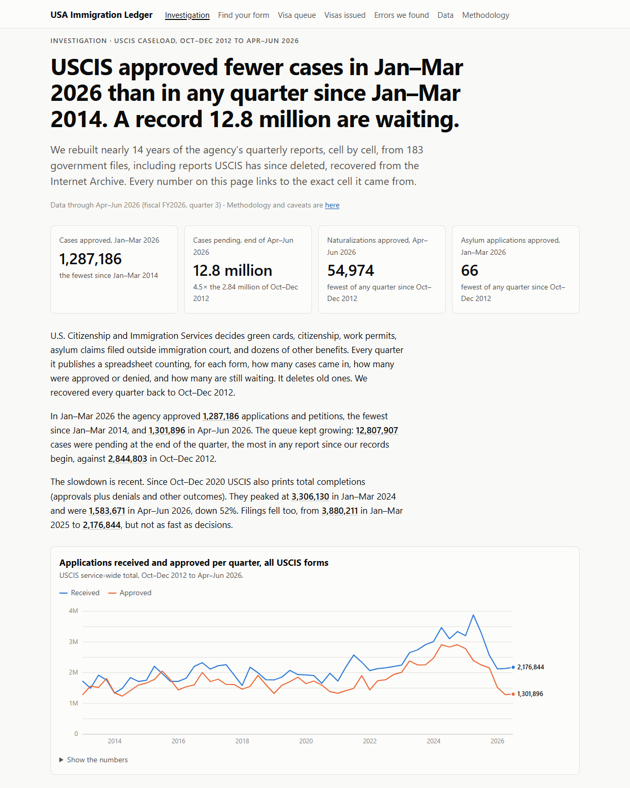

# USA Immigration Ledger

**Every USCIS caseload report since 2012, rebuilt cell by cell from the government's own spreadsheets, including reports the agency has deleted. Every number links to the exact cell it came from.**

[Read the investigation](https://usa-immigration-ledger.vercel.app) · [Find your form](https://usa-immigration-ledger.vercel.app/forms/) · [Download the data](https://usa-immigration-ledger.vercel.app/data/) · [Errors we found in the source](https://usa-immigration-ledger.vercel.app/source-errors/)



USCIS publishes its caseload as one spreadsheet per quarter, and deletes the old ones. The layout changes over time, footnote numbers are glued onto form numbers (`I-6007` is form I-600 with footnote 7), rows get split and renamed, and some years survive only as PDFs. This repo recovers all of them back to October 2012, using the Internet Archive for deleted files, and turns 183 government files into **one tidy, verifiable dataset** and a free website that reports on it. It also covers the State Department's monthly immigrant visa issuances since March 2017.

## What we found

Numbers through April–June 2026 (fiscal 2026, Q3). Every figure is on the site with a link to its source cell.

- **USCIS approved 1,287,186 cases in Jan–Mar 2026, fewer than in any quarter since early 2014.** Pending cases reached **12,807,907**, the most on record, up from 2.84 million at the end of 2012.
- **Naturalization approvals fell to their lowest point in the records:** 54,974 in Apr–Jun 2026. That's below the 78,008 of Apr–Jun 2020, when USCIS offices were closed for COVID-19.
- **Affirmative asylum approvals fell to 66** in Jan–Mar 2026, against a typical 2,000–7,000 per quarter, while 1.39 million asylum cases are pending.
- **The source files contain errors.** The FY2024 Q3 report repeats the previous quarter's median processing times, to 7+ significant digits, for 38 forms. Two I-130 visa-queue files carry the wrong date in their titles. FY2024 reports print counts with fractions (2,475,577.75 approvals). Older files print numbers with no label. State Department files list some Egypt and Jordan visa classes on two rows. [Full list with cell references →](https://usa-immigration-ledger.vercel.app/source-errors/)

We describe what the numbers show. We don't attribute causes the reports don't support. [Methodology and open questions for the agencies →](https://usa-immigration-ledger.vercel.app/methodology/)

## The dataset

Free under CC0. No sign-up, no API key.

| File | Contents |
|---|---|
| [`uscis-forms/facts.csv`](site/public/data/v1/uscis-forms/facts.csv) | Every USCIS form figure, FY2013 to today: received, approved, denied, completed, pending, median processing time, **with source file and cell for every value** |
| [`uscis-forms/wide.csv`](site/public/data/v1/uscis-forms/wide.csv) | Spreadsheet-friendly version: one row per form and quarter |
| [`uscis-i130-awaiting/facts.csv`](site/public/data/v1/uscis-i130-awaiting/facts.csv) | Approved family petitions waiting for a visa, by country and preference, quarterly since 2021 |
| [`state-iv/facts.csv`](site/public/data/v1/state-iv/facts.csv) | State Department immigrant visa issuances by country and visa class, monthly since March 2017 |
| [`sources.csv`](site/public/data/v1/sources.csv) | Every source file with original URL, SHA-256 and retrieval time |
| [`revisions.csv`](site/public/data/v1/revisions.csv) · [`checks.json`](site/public/data/v1/checks.json) | Numbers the government restated, and every consistency check |

```python
import pandas as pd
facts = pd.read_csv("https://usa-immigration-ledger.vercel.app/data/v1/uscis-forms/facts.csv")
facts.query("series_id == 'n-400' and measure == 'pending'")
```

## How it works

```
uscis.gov listing ──crawl────▶ archive/raw/  (byte-exact, SHA-256 named, never edited)
Internet Archive ──wayback──▶      │   (deleted files; each records the capture it came from)
State Dept files ──add──────▶      │
                                 ▼
      parsers (one per report family, every layout era; PDFs read by word position)
                                 │  verbatim labels + exact cell of every value
                                 ▼
             catalog/uscis-forms.toml  (human-reviewed: which rows are the same form across years)
                                 │  unknown row ⇒ build fails with a suggested fix
                                 ▼
                ledger: (series, period, measure) → value + cell  ──▶ checks (published)
                                 │
                                 ▼
            site/public/data/v1/  ──▶  Astro static site on Vercel (no server, no database)
```

Rules: no guessing (an unparseable cell or unknown row stops the build); a dash or "N/A" is never turned into 0; quarters USCIS doesn't publish stay as gaps; a later printing of a number wins and the earlier one is kept in `revisions.csv`; prose on the site pulls every number from the data at build time, so text can't drift from data.

The architecture rationale is in [`docs/architecture.md`](docs/architecture.md). The verification record for each published claim is in [`docs/verification-trail.md`](docs/verification-trail.md).

## Run it yourself

Requires Python 3.11+ and Node 22+.

```bash
pip install -r pipeline/requirements.txt
PYTHONPATH=pipeline python -m usdata crawl    # fetch new files from uscis.gov (polite, identified, stops on 403/429)
PYTHONPATH=pipeline python -m usdata wayback --dataset uscis-forms   # recover deleted files from the Internet Archive
PYTHONPATH=pipeline python -m usdata build    # archive + catalog -> site/public/data/v1
python -m pytest                              # hand-verified pins, parsers, determinism
cd site && npm install && npm run dev         # http://localhost:4321
```

**Adding State Department files.** travel.state.gov blocks automated downloads, and we don't work around that. Older months come from the Internet Archive (`wayback --dataset state-iv`). For new months, download the monthly "IV Issuances by FSC or Place of Birth and Visa Class" files in a browser, then:

```bash
PYTHONPATH=pipeline python -m usdata add ~/Downloads/*.xlsx --dataset state-iv
```

**Automation.** A weekly GitHub Action crawls uscis.gov and opens a pull request when new files appear. It never pushes to `main`. CI runs the tests, checks that the committed data equals a fresh build, and builds the site. Vercel deploys `main` from the `site/` directory.

## Contributing

The most useful contributions:

- **Spot an error?** [Open an issue](https://github.com/sigmalgebra/usa-immigration-ledger/issues/new) with the series, quarter and what the source file says. Corrections are logged on the methodology page.
- **New USCIS row names** after a refresh: add them to `catalog/uscis-forms.toml`. The build error prints the snippet to paste.
- **More datasets**: net backlog, N-400 by field office and H-1B employer data are on the same USCIS listing. Each needs a parser in `pipeline/usdata/datasets/` and pins in `pipeline/tests/pins.toml`.

## License

Code: [MIT](LICENSE). Data: [CC0](https://creativecommons.org/publicdomain/zero/1.0/). The underlying files are U.S. government works. Not affiliated with USCIS, DHS or the Department of State.

<details>
<summary>History</summary>

This repo began as a Streamlit dashboard of State Department visa issuances (now in [`legacy/`](legacy/)). The repo name says USCIS, but that data came from the State Department, which issues visas abroad. USCIS, part of DHS, decides benefits inside the U.S. The ledger now covers both and labels each.
</details>
